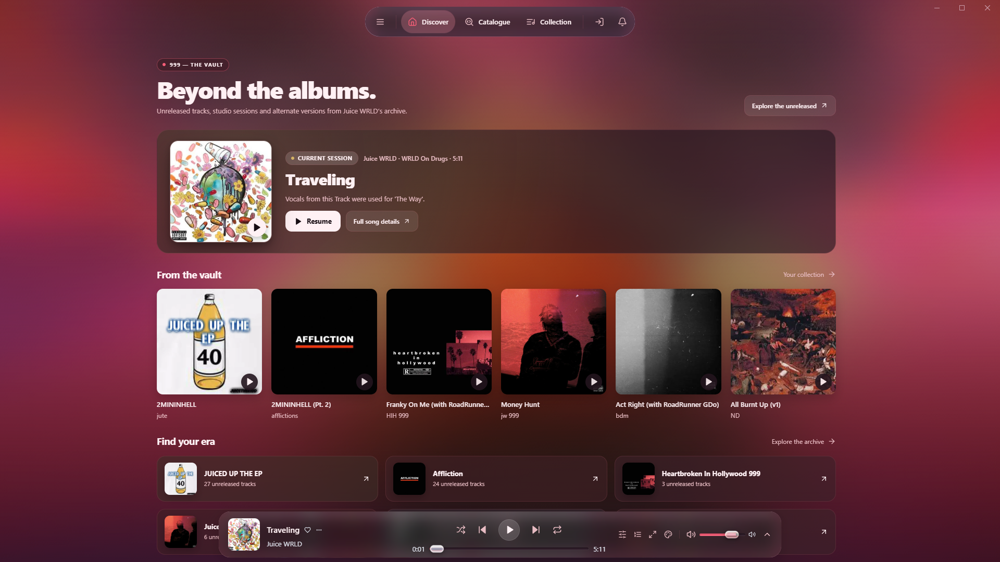
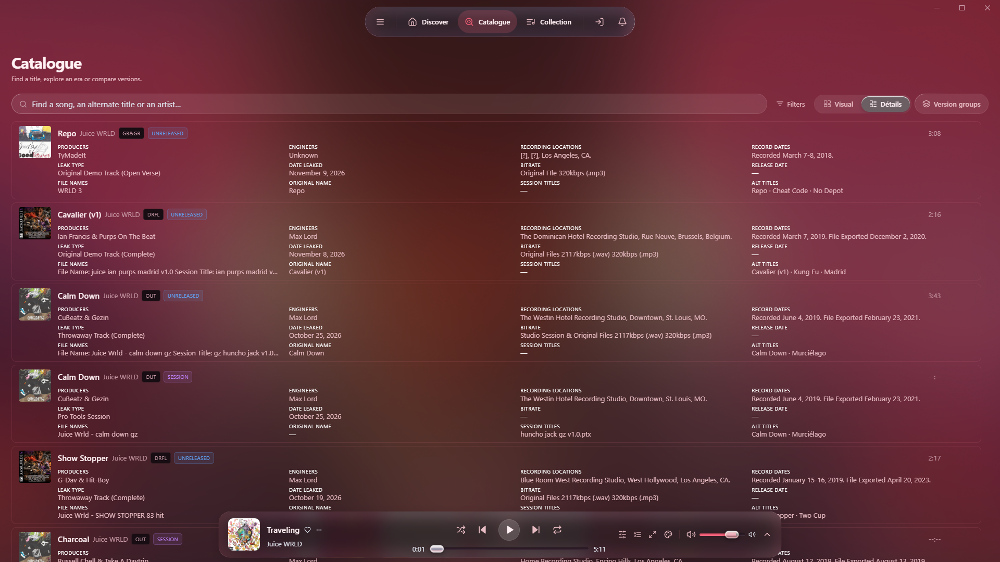

# Unreleased Glass

A desktop music player for exploring Juice WRLD's released and unreleased catalogue, organizing your music and listening with fullscreen lyrics.

Built from [Unreleased](https://github.com/Juice-WRLD-API/Unreleased), with a cover-led interface, glass controls and a simpler everyday layout.

## What you can do

- **Discover more music.** Explore Juice WRLD's eras, unreleased tracks, studio recordings and alternate versions through their cover art.
- **Find the version you want.** Search the catalogue, compare versions and open a song's credits, notes and related footage.
- **Keep your music together.** Use playlists, liked songs, albums and local files, with offline downloads for listening without a connection.
- **Listen with lyrics.** Open WRLD for fullscreen artwork and synchronized lyrics. Choose a lyric presentation or hide the controls for a cleaner listening screen.
- **Tune in to 999 FM.** Listen to the live station and join its chat. Resuming the radio brings you back to the live broadcast.
- **Choose your look.** Switch between Light, Dark and album themes. You can also let the app's colors follow the playing cover, or use Game & economy mode for a calmer background.

Catalogue information and available audio come from the [Juice WRLD API](https://juicewrldapi.com). Some catalogue entries have information but no playable audio.

## What's different in Glass?

Discover, Catalogue and Collection put everyday listening first: larger covers, eras in chronological order, direct playback and fewer technical controls on screen. The original app's advanced tools remain available through Developer options.

Footage shows a real frame from each video, loaded as you scroll, with a plain "View song" action when a video clearly belongs to a catalogue song. Every list can be expanded, so the whole archive is reachable.

The interface adds translucent glass controls and cover-inspired backgrounds. WRLD brings artwork and lyrics into one listening view, with clear ways to return to your music or change the atmosphere.

WRLD's lyric menu also offers Cut, a cut-up type style where each word lights as it is sung, in dark and light themes.

## Installation

Open [Releases](https://github.com/GoodFight37/Unreleased-Glass-Releases/releases) and download the file for your system:

- **Windows:** the `.exe` installer. Run it, then open **Unreleased Glass** from the Start menu. Installed versions update themselves.
- **Linux:** the `.AppImage`. Make it executable (`chmod +x`) and run it. The AppImage also updates itself.
- **macOS:** the `.dmg` (Apple silicon and Intel). The app is not code-signed, so macOS may ask you to confirm the first launch. Updates are manual: download the new `.dmg` and replace the app.

Windows is the platform that is used and tested the most. Linux builds are tested in CI; macOS builds are produced by CI but have not been checked on a real Mac.

Installed versions check this repository for updates (its releases hold the installers and update manifests). Glass uses its own profile and keeps the original Unreleased installation separate. Before the first launch, close the original player so Glass can import its preferences. Imported offline files are copied, which can require extra disk space.

## About this repository

This repository only hosts what Unreleased Glass ships: the installers, the update manifests (`latest*.yml`) and the synchronized-lyrics pack that the app downloads. The application's source code is kept in a private repository.

## Credits and license

- Catalogue information, archive files and the API: the [Juice WRLD API](https://juicewrldapi.com) and its maintainers.
- The original player: [Unreleased](https://github.com/Juice-WRLD-API/Unreleased) by the Unreleased team. Unreleased Glass is built from it.
- Unreleased Glass keeps the original [MIT license](LICENSE), Copyright (c) 2026 leanwrldd. Bundled third-party licenses are listed in [THIRD-PARTY-NOTICES.md](THIRD-PARTY-NOTICES.md).
