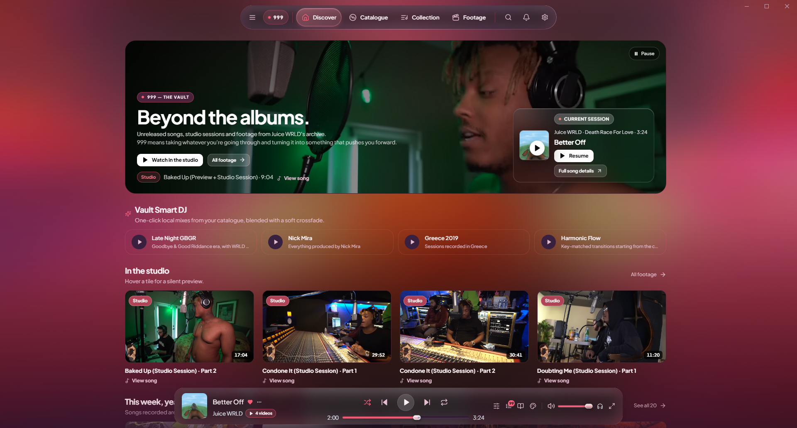
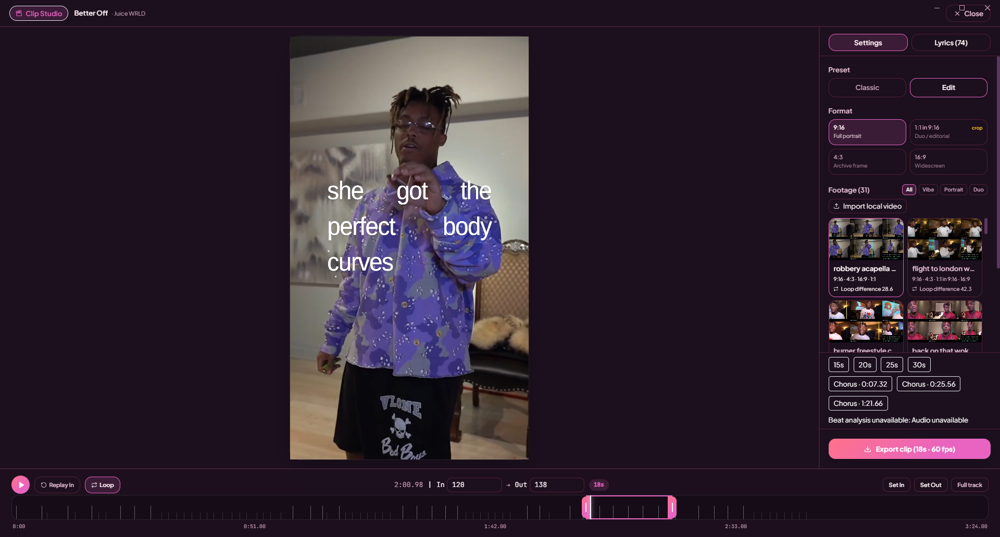

# Unreleased Glass

**A next-generation desktop Juice WRLD player** — built with Electron, React, TypeScript, and a custom **WebGPU Liquid Glass** compositor. Explore the full released & unreleased catalogue, watch studio footage, listen on a full-bleed lyrics stage, and export 60 fps clips directly from the app.

---

## Highlights

- **WebGPU Liquid Glass Compositor** — Real-time multi-layer optical refraction, half-resolution backdrop blur, adaptive cover-driven color palettes, and WCAG AA contrast across **Light**, **Dark**, and **5 album themes** (*999*, *GB&GR*, *DRFL*, *LND*, *FD*), with automatic SVG fallback when WebGPU is unavailable.
- **Cover-Led Discover & Vault Smart DJ** — Chronological Juice WRLD eras, *This Week in History*, studio-session hero previews, and one-click **Vault Smart DJ** mixes (*Late Night GBGR*, *Nick Mira*, *Greece 2019*, *Harmonic Flow* key/BPM-matched transitions).
- **WRLD Fullscreen Stage & Lyric Engines** — Fullscreen artwork + synchronized lyrics with multiple presentation styles (*Classic*, *Focus*, *Editorial* phrase chunking, *Cut*, *Cinema*, *Fisheye*), live audio-reactive 808 edge rims, and the **Stage Bouncer** (album-cover / butterfly physics synced to lyric cues and theme palettes).
- **Clip Studio (60 fps MP4 Export)** — Built-in CapCut-style timeline with **In → Out** trimming, chorus snap markers, **Classic** (WRLD stage) and **Edit** (video footage + OFL lyric styles) presets, **9:16**, **16:9**, **4:3** & **1:1** formats, and deterministic 60 fps hardware-accelerated (`h264_nvenc` / `libx264`) MP4 export.
- **Desktop Widgets & Edge Light** — Clear-desk desktop lyrics widgets (*Cut*, *Karaoke*, etc.), audio-reactive screen edge lighting, mini-player / pop-out windows, Discord Rich Presence, and Windows taskbar media controls.
- **Full Archive, Offline Vault & 999 FM** — Search every song, version group, studio session, and photo/video archive; download tracks & playlists for offline playback (including automatic ALAC-to-FLAC transcoding); tune in to **999 FM** live radio with chat; play **Heardle**; or open the built-in **Terminal** and **10-band EQ + FX** chain.

---

## Gallery

### Catalogue & Album Themes

### WRLD Listening Stage

### Clip Studio — 60 fps Export

---

## Installation

Open [Releases](https://github.com/GoodFight37/Unreleased-Glass-Releases/releases) and download the installer for your system:

- **Windows:** `.exe` installer — run it, then launch **Unreleased Glass** from the Start menu (supports automatic background updates).
- **Linux:** `.AppImage` — mark executable (`chmod +x`) and run (supports automatic updates).
- **macOS:** `.dmg` (Apple silicon & Intel) — unsigned build; confirm first launch in macOS Security settings if prompted.

Installed versions use an isolated Unreleased Glass profile and check `GoodFight37/Unreleased-Glass-Releases` for updates. Catalogue metadata and available streams come from the [Juice WRLD API](https://juicewrldapi.com).

---

## Credits & License

Built on top of [Juice-WRLD-API/Unreleased](https://github.com/Juice-WRLD-API/Unreleased). See [LICENSE](LICENSE) for details.
