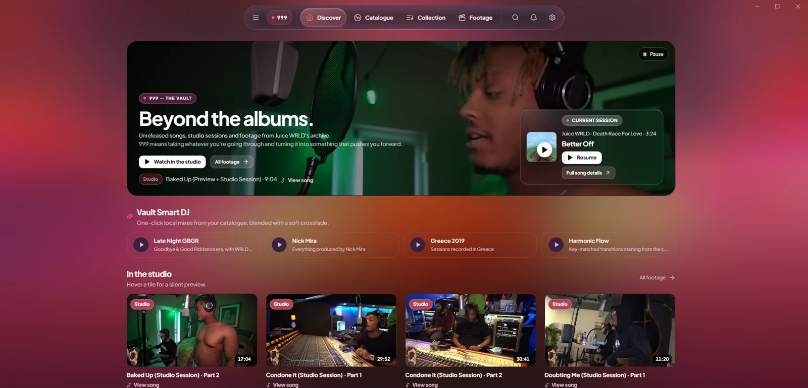
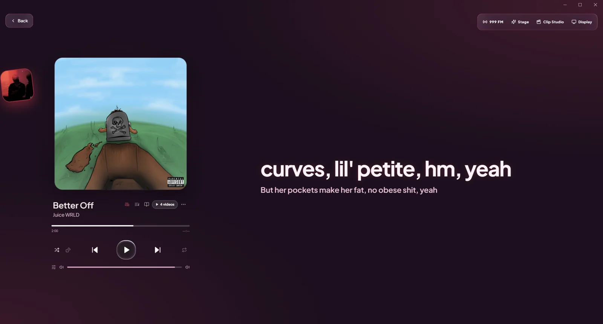
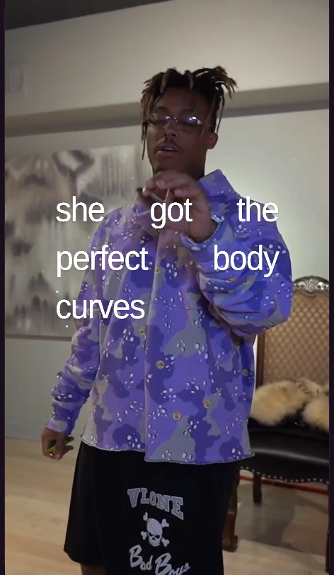
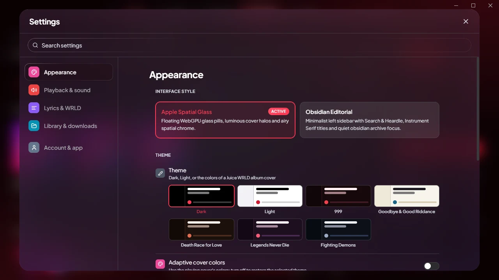

<div align="center">

# Unreleased Glass

**A clean, focused desktop player for Juice WRLD's released and unreleased music.**<br>
Built on top of the original Unreleased app — simplified, polished, and designed around the listening experience.

[](https://github.com/GoodFight37/Unreleased-Glass-Releases/releases/latest)
[](https://github.com/GoodFight37/Unreleased-Glass-Releases/releases)


### [⬇ Download for your system](https://goodfight37.github.io/Unreleased-Glass-Releases/)

<sub>Free · Auto-updates on Windows and Linux · Detects your OS</sub>

<br>



</div>

---

## What's improved in Unreleased Glass

Unreleased Glass builds on the great foundation of [Juice-WRLD-API/Unreleased](https://github.com/Juice-WRLD-API/Unreleased) and the [Juice WRLD API](https://juicewrldapi.com). Our goal is simple: remove the clutter, fix everyday bugs, and make listening feel smooth, safe, and effortless.

| Focus | What it means for you |
|---|---|
| **Less clutter, more music** | Unused menus and extra toggles were stripped out so Settings stays clean (5 clear pages) and every screen is easy to navigate. |
| **Liquid Glass & album themes** | Soft translucent glass controls that adapt to the cover art you're playing, plus **Dark**, **Light**, and **5 Juice WRLD album themes** (*999*, *GB&GR*, *DRFL*, *LND*, *Fighting Demons*). |
| **Fullscreen lyrics & visuals (WRLD)** | Big, accurate synced lyrics over live visualizers, a floating glass cover carousel, screen edge lights, and bouncing album covers. |
| **Built-in 60 fps Clip Studio** | Pick any moment of a track, choose bouncing cover art or studio footage with word-by-word lyrics, and export a crisp 60 fps MP4 for TikTok, Reels, or Shorts. |
| **Faster & fewer bugs** | Instant **`Ctrl+K`** search that still finds songs even with typos, smooth scrolling across thousands of tracks, reliable offline playback (including lossless files), and a clear notice if the server is temporarily down. |
| **Desktop-first comfort** | Native desktop widgets (crisp clock, mini player, up-next queue), floating desktop lyrics, global media keys, tray controls, and Discord Rich Presence. |
| **Built with safety in mind** | Verified downloads (SHA-256), quiet background updates, automatic integrity checks for helper tools, and a separate profile so your original Unreleased setup is never overwritten. |

---

## What you get

### Beyond the albums
Open **Discover** and land straight in the vault: studio-session footage that plays silently as you hover, one-click mixes (*Late Night GBGR*, *Nick Mira*, *Greece 2019*, *Harmonic Flow*) and an **On this day** shelf showing what was previewed years ago. Compare every version of a song in the catalogue, or press **`Ctrl+K`** to jump to any track, era, or action in a second.

### Lyrics that fill the screen
Synced lyrics, big and in time, over a glowing backdrop and live visualizers that shine right through the glass.



### Make a clip in seconds
Pick the part of a song on a visual timeline, choose **Classic** (bouncing album cover and lyrics) or **Edit** (studio footage and lyrics), and export a **60 fps MP4** in 9:16, 1:1, 4:3 or 16:9, ready to post.

<div align="center">

</div>

### Make it yours
**Dark**, **Light** and five album themes: *999*, *Goodbye & Good Riddance*, *Death Race for Love*, *Legends Never Die* and *Fighting Demons*. Five clear settings pages, no maze.



### And more
- **Offline listening**: download songs and playlists so your music stays ready even without internet.
- **Your own files**: add local folders straight from your computer.
- **999 FM** live radio and **Heardle** to guess the track.
- **Desktop widgets**: crisp clock, player, queue, floating lyrics, and soft light around your screen edges.
- **Smooth on every setup**: respects reduced-motion preferences and includes an Economy / Game mode when you want to save power.

---

## Install

Pick your system on the **[download page](https://goodfight37.github.io/Unreleased-Glass-Releases/)** (it detects it for you), or grab the file from the **[latest release](https://github.com/GoodFight37/Unreleased-Glass-Releases/releases/latest)**.

| System | File | First launch |
|---|---|---|
| **Windows** | `.exe` installer | Double-click, then open **Unreleased Glass** from the Start menu. Updates install themselves. |
| **macOS** Apple Silicon (M1–M4) | `-arm64.dmg` | Open it, drag the app into **Applications**. If macOS refuses, right-click the app → **Open**. |
| **macOS** Intel | `.dmg` | Same as above. |
| **Linux** | `.AppImage` | Right-click → **Properties → Allow executing as program** (or `chmod +x`), then open it. |

> Already used the original Unreleased app? Close it once before the first launch so your playlists and settings can be imported automatically. Your original profile stays completely separate and safe.

<details>
<summary><b>Windows says "Windows protected your PC"?</b></summary>

<br>

The installer is not signed with a paid certificate (it costs hundreds of dollars a year, and this project is free). So Windows SmartScreen asks for confirmation the first time:

1. Click **More info**.
2. Click **Run anyway**.

You only do this once. Want to be sure the file is the exact one published here? Compare its SHA-256 with the value in the release notes (every release lists them). In PowerShell:

```powershell
Get-FileHash .\Unreleased-Glass-Setup-<version>.exe -Algorithm SHA256
```

The two values must match exactly. If they don't, don't run the file and open an [issue](https://github.com/GoodFight37/Unreleased-Glass-Releases/issues).

</details>

---

## Credits & license

Music metadata and streams come from the [Juice WRLD API](https://juicewrldapi.com). Built with appreciation on top of [Juice-WRLD-API/Unreleased](https://github.com/Juice-WRLD-API/Unreleased). See [LICENSE](LICENSE) and [THIRD-PARTY-NOTICES.md](THIRD-PARTY-NOTICES.md).
