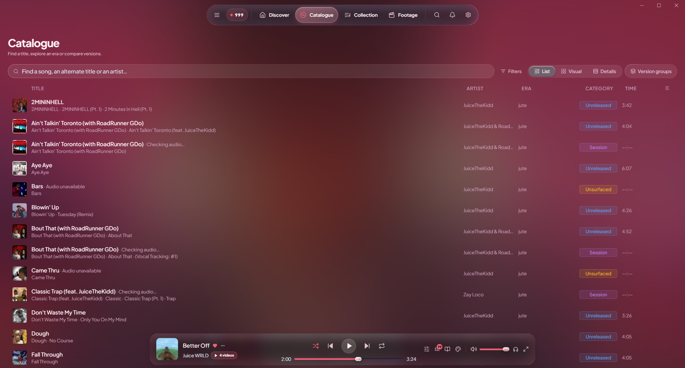

# Unreleased Glass

**A sleek desktop music player for Juice WRLD's released and unreleased music** — featuring translucent Liquid Glass visuals, album-inspired themes, fullscreen synced lyrics, studio footage, and a built-in 60 fps video clip exporter.

---

## Download & Install

1. Go to the **[Latest Release page](https://github.com/GoodFight37/Unreleased-Glass-Releases/releases/latest)** and scroll down to **Assets**.
2. Download the file for your computer:
   - **Windows (`.exe`)** — Double-click the installer, then open **Unreleased Glass** from your Start menu. Future updates install automatically. *(If Windows SmartScreen pops up, click **More info → Run anyway**.)*
   - **Mac (`.dmg`)** — Open the file and drag **Unreleased Glass** into **Applications**. *(On first launch, right-click the app → **Open** if macOS asks.)*
   - **Linux (`.AppImage`)** — Right-click → **Properties → Allow executing file as program** (or `chmod +x`), then open it. Updates automatically.

> Your existing profile stays safe and separate. If you used the original Unreleased app before, close it once before launching Unreleased Glass so your playlists and settings can be imported automatically.

---

## Why You'll Love It

- **Liquid Glass & Album Themes** — Translucent glass controls and glowing backgrounds that adapt to whatever cover is playing, plus **Dark**, **Light**, and **5 Juice WRLD album themes** (*999*, *Goodbye & Good Riddance*, *Death Race for Love*, *Legends Never Die*, *Fighting Demons*).
- **Discover & Smart Mixes** — Browse eras in chronological order, preview real studio-session footage right on the home screen, and start one-click mixes (*Late Night GBGR*, *Nick Mira*, *Greece 2019*, *Harmonic Flow*).
- **Fullscreen Lyrics & Bouncing Cover** — Multiple lyric styles, beat-reactive glowing edges, and a DVD-style bouncing album cover that switches themes on corner hits.
- **Clip Studio (Export for TikTok, Reels & Shorts)** — Trim any part of a song on a visual timeline, pick **Classic** (bouncing cover + lyrics) or **Edit** (studio footage + lyrics), and export a crisp **60 fps MP4** ready to post.
- **Desktop Lyrics & Screen Glow** — Float synced lyrics directly over your desktop and light up your screen edges to the beat.
- **Offline Listening, 999 FM & Heardle** — Download songs and playlists for offline playback, listen to **999 FM** live radio with chat, or play **Heardle** to guess the track.

---

## Gallery

### Catalogue & Album Themes

### Fullscreen Lyrics Stage

### Clip Studio — 60 fps Video Export

---

## Credits & License

Music metadata and streams are provided by the [Juice WRLD API](https://juicewrldapi.com). Built on top of [Juice-WRLD-API/Unreleased](https://github.com/Juice-WRLD-API/Unreleased). See [LICENSE](LICENSE) for details.
